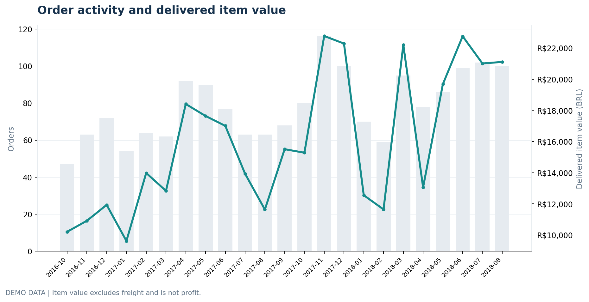
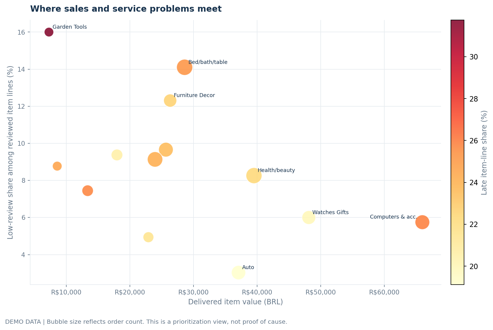
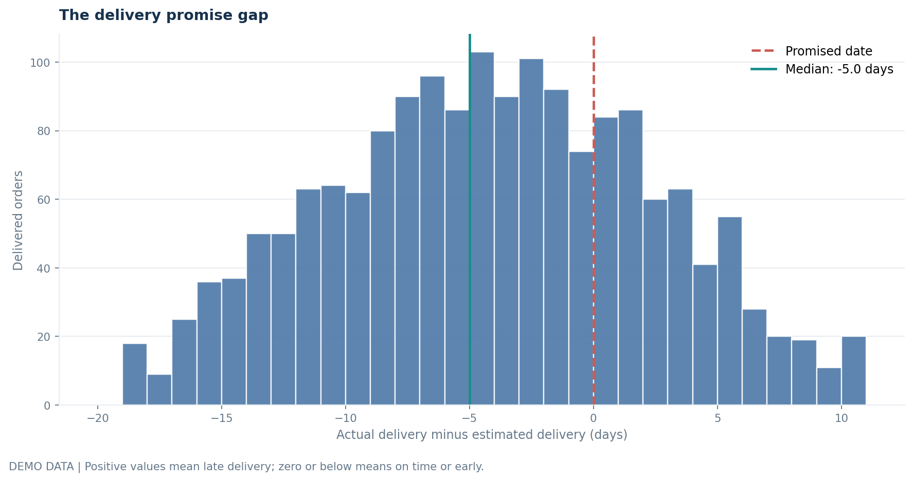
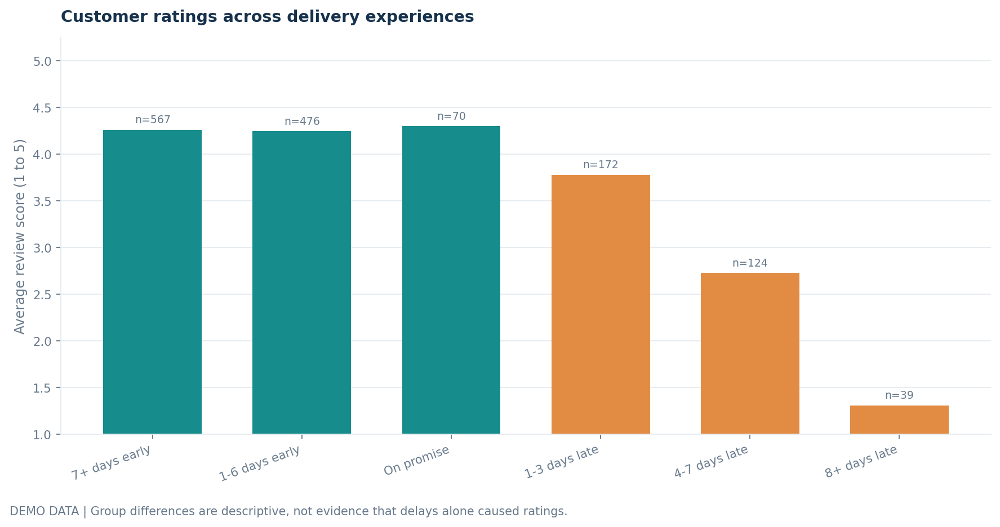

# E-commerce Business Performance and Profitability Signals

This project looks at a simple business question: where is an online marketplace doing well, and where could the buying and delivery experience be costing it future orders?

The analysis brings together orders, item prices, freight, delivery dates, customer reviews, product categories and sellers. It includes a small synthetic dataset, so the code, dashboard and report run without a Kaggle account. The demo rows are not Olist's data. The figures in the included report and screenshots are demonstrations, not claims about a real marketplace.

To get results from the original public dataset, download the files from Olist's Kaggle page and rerun the project. The dataset is free to download with a Kaggle account, but it is published under **CC BY-NC-SA 4.0**, so check the terms before sharing adaptations or using it commercially.

## What is in the project

- A business review with a clear set of questions and recommended follow-up work.
- A Python analysis that joins the source tables and creates an order-level fact table.
- A standalone interactive dashboard in `outputs/dashboard.html`.
- Six static charts in `visualizations/`, ready to use in a report or presentation.
- A service-recovery budget planner in `outputs/service_recovery_planner.html`. Change the contact rate and estimated cost per contact to size a possible workload. It does not forecast saved revenue.
- CSV summary tables, data-quality checks and a SQLite database.
- SQL examples for monthly performance, category screening and the seller review queue.
- A PDF report in `reports/marketplace_performance_review.pdf` and its Markdown notes in `outputs/analysis_summary.md`.

## Questions covered

1. How are order activity and delivered item value changing over time?
2. Which product categories contribute the most item value, and which show higher levels of late delivery or low reviews?
3. How often do delivered orders miss the estimated delivery date?
4. How do review scores differ across delivery experiences?
5. Which sellers should operations review first, after filtering out small samples?
6. Which customer groups place another order in later months?
7. How much item value is associated with orders that were both late and rated 1 or 2?

The last measure is a service flag, not lost revenue. The source does not include enough cost information to calculate profit or margin.

## Screenshots

### Monthly performance



### Category opportunity map



### Delivery promise gap



### Customer feedback by delivery experience



## Run it locally

Python 3.10 or newer is recommended.

```bash
python -m venv .venv
```

Activate the environment, then install the packages:

```bash
pip install -r requirements.txt
```

Run the full project using the included demonstration data:

```bash
python run_project.py --source demo
```

This rebuilds the outputs, interactive dashboard, SQLite database and PDF report. Open `outputs/dashboard.html` in a browser to explore the charts. The HTML file contains its plotting library, so it does not need a network connection to render.

## Use the original Olist data

1. Create a free account at [Kaggle](https://www.kaggle.com/).
2. Open the [Brazilian E-Commerce Public Dataset by Olist](https://www.kaggle.com/datasets/olistbr/brazilian-ecommerce) and review its terms.
3. Download the dataset ZIP and extract the CSV files into `data/raw/`, or configure the Kaggle CLI and run:

   ```bash
   pip install kaggle
   python scripts/download_data.py
   ```

4. Run the analysis against the downloaded files:

   ```bash
   python run_project.py --source raw
   ```

If the CLI is used, configure Kaggle credentials according to its documentation first. The project does not need a paid API key or paid data source. Keep `data/raw/` out of your public Git repository unless you have checked that your intended redistribution is allowed. The included `.gitignore` already excludes the raw CSV files.

`--source auto` uses the original data if the required CSV files are present; otherwise it uses the demo tables.

## How the analysis is put together

The analysis starts with one row per order. Item prices and freight are summed from the order-items table, payments are summed separately, and reviews are grouped to the order level. Customer identity is joined through the customer table. Product categories and sellers are brought in at item level for the category and seller scorecards.

The `promise_gap_days` field is actual delivery date minus estimated delivery date. Positive values mean the order arrived late; zero or negative values mean it arrived on time or early.

The category view carries an order review onto the item's category when an order contains multiple products. This is useful for finding categories worth a closer look, but it is not a product-specific rating. The seller service-friction index is a simple screening score, weighted 55% toward late deliveries and 45% toward low reviews. It is not an official seller KPI.

Read `docs/METHODOLOGY.md` for the metric definitions and limits.

## Main output files

| File | Use |
|---|---|
| `outputs/dashboard.html` | Interactive performance dashboard |
| `outputs/service_recovery_planner.html` | Workload and cost scenario tool |
| `outputs/metrics.json` | Headline measures for the latest run |
| `outputs/tables/order_fact.csv` | One row per order with derived fields |
| `outputs/tables/item_fact.csv` | Item rows joined to product categories |
| `outputs/tables/category_performance.csv` | Category summary |
| `outputs/tables/seller_service_scorecard.csv` | Seller screening scorecard |
| `outputs/tables/customer_cohort_activity.csv` | Repeat-order activity by first-order month |
| `outputs/tables/data_quality_checks.csv` | Checks to review before interpreting the results |
| `outputs/marketplace_analysis.db` | SQLite database for the SQL examples |
| `reports/marketplace_performance_review.pdf` | PDF business review |

## Important limits

- The original Olist data covers historical orders from 2016 to 2018, not current performance.
- Item value is not net revenue, and item value plus freight is not profit.
- The source does not contain a complete cost-of-goods, returns, refunds, discounts, marketing, tax or operating-expense ledger.
- Reviews are self-selected. Not every buyer leaves one.
- Descriptive relationships do not prove cause and effect.
- Recent customer cohorts have less time to place another order than older cohorts.

## Data source and credit

Olist and Andre Sionek (2018), *Brazilian E-Commerce Public Dataset by Olist*, Kaggle: <https://www.kaggle.com/datasets/olistbr/brazilian-ecommerce>. The published dataset is licensed under CC BY-NC-SA 4.0. The synthetic demo tables in this repository were generated for testing and do not reproduce the original records.

## License

The code in this repository is available under the MIT License. The Olist data, when downloaded, remains subject to its own license. See `DATA_LICENSE.md`.
